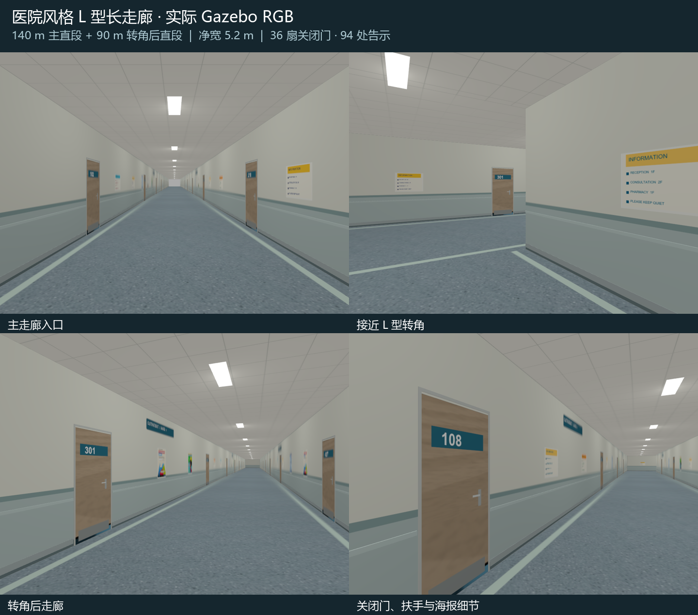
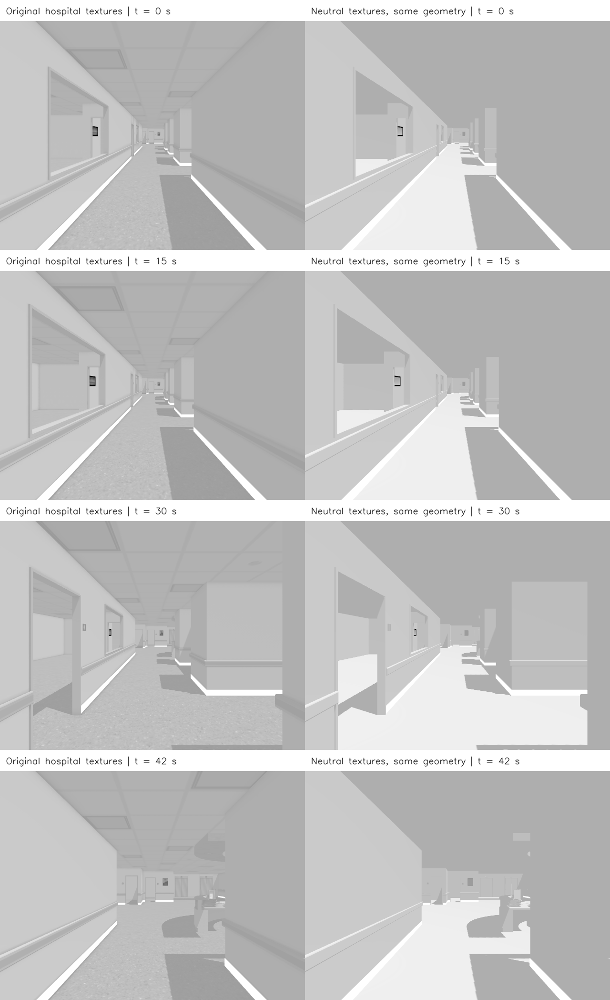

# SOWA-LIVO

### Spatial Observability-aware Weight Adaptation

**Direction-aware information weighting for tightly coupled LiDAR, visual, and inertial localization.**

[简体中文](README.zh-CN.md) · [Releases](https://github.com/Zhuyicheng-HIT/SOWA-LIVO/releases)

The paired scene uses identical geometry with rich and low-texture surfaces:

## Method

SOWA evaluates directional responses in the measurement Jacobian, separates a target direction from coupled state responses, and adapts the contribution of that measurement subspace. Reliable visual information remains in the coupled estimator update.

For measurement Jacobian $H$ and covariance $R$, the whitened block is $A=R^{-1/2}H$. A direction is evaluated after projecting out the other mapped directions and nuisance-state responses. The selected measurement mode can then be softly retained while its orthogonal complement is scaled, applying the same transform to $A$ and the whitened residual.

## Recorded result

The best recorded full-route replay is v0.7.6: x/y/z RMSE 0.4644/0.2078/0.0431 m and 3D RMSE 0.5106 m over 2441 samples at fixed metric scale.

| Method | x RMSE (m) | y RMSE (m) | z RMSE (m) | 3D RMSE (m) |
| --- | ---: | ---: | ---: | ---: |
| Pure VIO | 1.0490 | 0.3093 | 0.2796 | 1.1288 |
| Pure LIO | 576.2386 | 5.4321 | 0.4939 | 576.2644 |
| Tightly coupled baseline | 0.8872 | 0.2896 | 0.1813 | 0.9524 |
| **SOWA-LIVO v0.7.6** | **0.4644** | **0.2078** | **0.0431** | **0.5106** |

Exact run inputs and their hashes are documented in [the v0.7.6 audit](docs/code-audit-v076.md).

## Source

The complete estimator source is in estimator/, the C++ core in estimator/sowa_core/, the Gazebo scene and capture tools in simulation/, and existing metrics in results/. See docs/build.md for dependencies and build steps.

## License

Estimator and SOWA core sources use GPL-2.0. Scene assets retain their individual notices. Original source copyright and license headers are retained.
