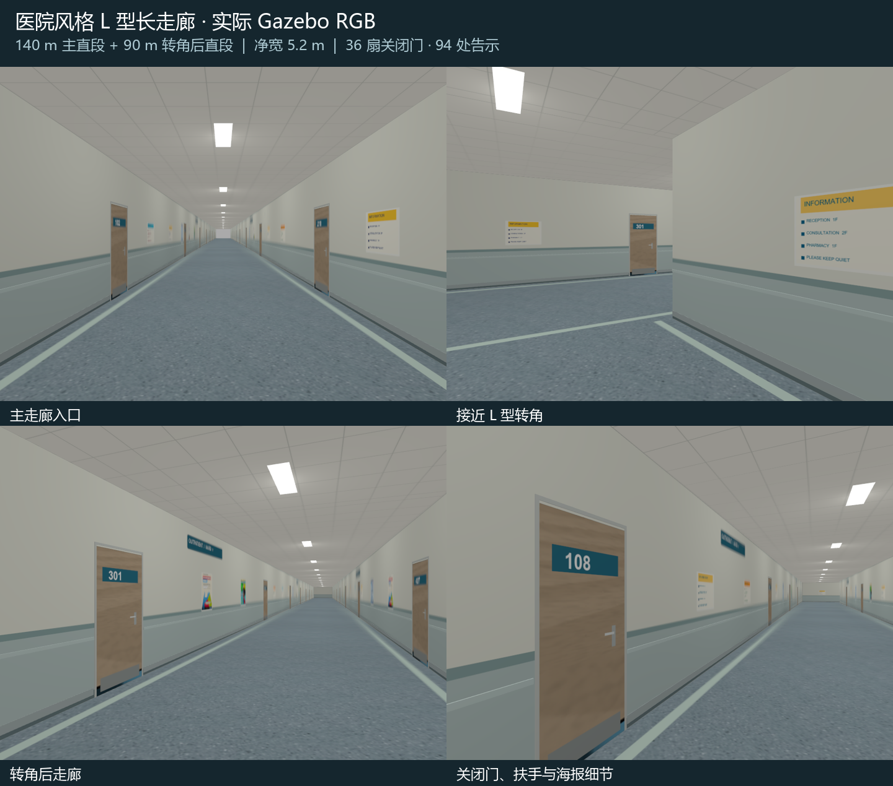

# SOWA-LIVO

### Spatial Observability-aware Weight Adaptation

面向紧耦合激光、视觉与惯性定位的方向自适应信息加权。

[](https://github.com/Zhuyicheng-HIT/SOWA-LIVO/releases/latest)
[](LICENSE)
[](docs/build.md)

[English](README.md) · [发布版本](https://github.com/Zhuyicheng-HIT/SOWA-LIVO/releases)



## 算法思路

长走廊各方向约束不均衡：激光可能对横向和竖直运动约束较强，而前向运动可观测性较弱。SOWA从测量 Jacobian 评价方向响应，将目标方向与耦合状态响应分离，再自适应调节对应测量子空间的贡献。可靠视觉观测仍参与紧耦合更新。

视觉 Route A 保留条件前向模态，对其正交测量补空间施加软尺度；白化 Jacobian 与残差使用同一变换，使信息贡献保持半正定且二者一致。

对 Jacobian $H$ 和协方差 $R$，先构造白化观测 $A=R^{-1/2}H$。投影掉其他方向与干扰状态后得到目标方向模态 $u$。Route A 使用 $M=sI+(1-s)uu^T$，并同步更新 $A'=MA$ 与 $b'=Mb$；当 $0<s\le1$ 时，$M^TM\preceq I$，因此不会增加测量信息。

## 当前最佳记录

最高精度的全路线回放为 v0.7.6：x/y/z RMSE 分别为 0.4644/0.2078/0.0431 m，3D RMSE 为 0.5106 m。评价共 2441 个样本，使用固定米制尺度。

| 方法 | x RMSE（m） | y RMSE（m） | z RMSE（m） | 3D RMSE（m） |
| --- | ---: | ---: | ---: | ---: |
| 纯 VIO | 1.0490 | 0.3093 | 0.2796 | 1.1288 |
| 纯 LIO | 576.2386 | 5.4321 | 0.4939 | 576.2644 |
| 紧耦合基线 | 0.8872 | 0.2896 | 0.1813 | 0.9524 |
| **SOWA-LIVO v0.7.6** | **0.4644** | **0.2078** | **0.0431** | **0.5106** |

指标来源见 [results/long_l_baselines.csv](results/long_l_baselines.csv)，回放、输入哈希及源码审计见 [docs/code-audit-v076.md](docs/code-audit-v076.md)。

## 构建

完整估计器源码位于 estimator/，可复用 C++ 核心位于 estimator/sowa_core/，场景与采集脚本位于 simulation/。部署不下载估计器源码。ROS 1 依赖与构建步骤见 [docs/build.md](docs/build.md)。

```text
estimator/    ROS 1 估计器、SOWA 适配层与 C++ 核心
simulation/   Gazebo 走廊、纹理素材及 RGB/激光/IMU 采集工具
results/      已有四种方法的长走廊指标
docs/         构建说明、源码审计与场景预览
```

## 许可

估计器与 SOWA 核心采用 GPL-2.0。走廊素材的许可声明保存在 simulation/scenes/hospital_l_corridor_v1/。原始源文件版权和许可头均予以保留。
